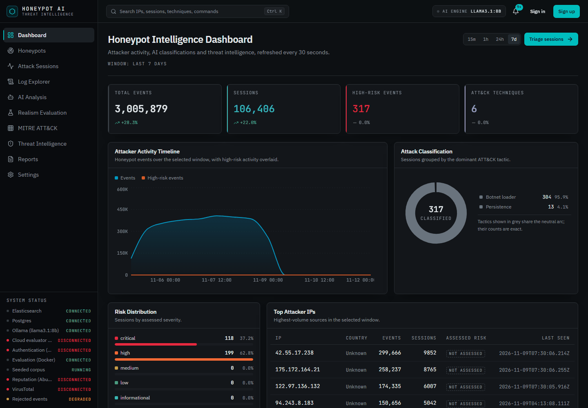
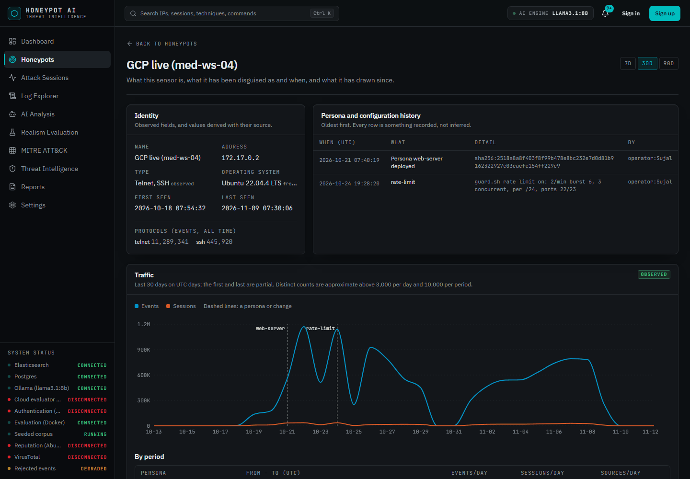
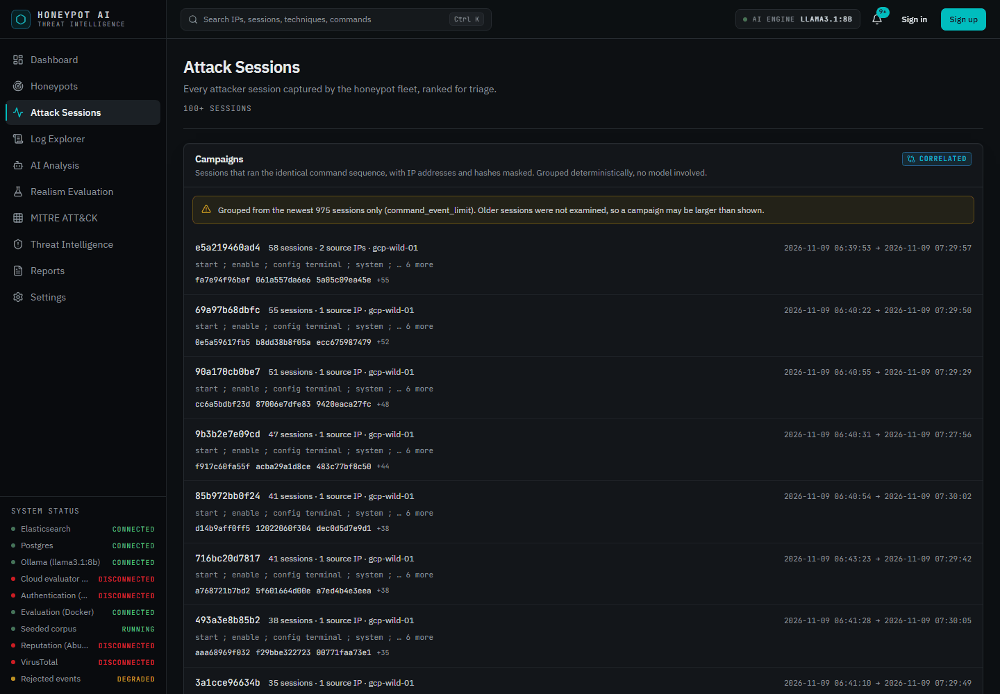
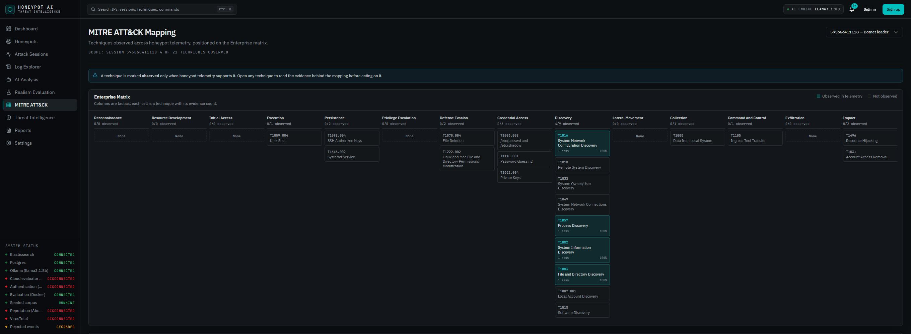
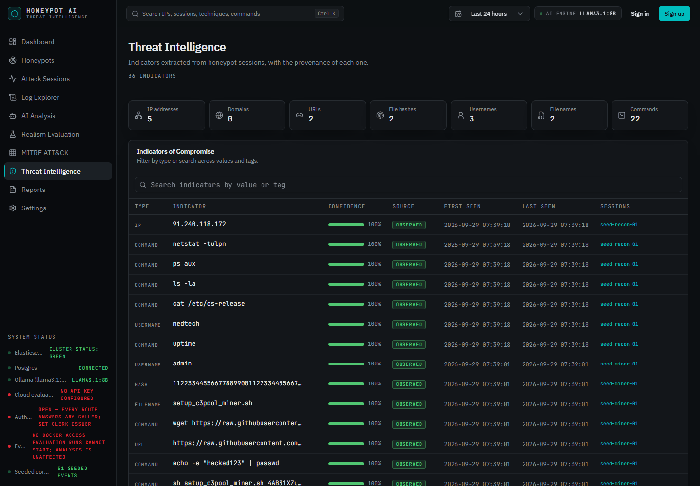
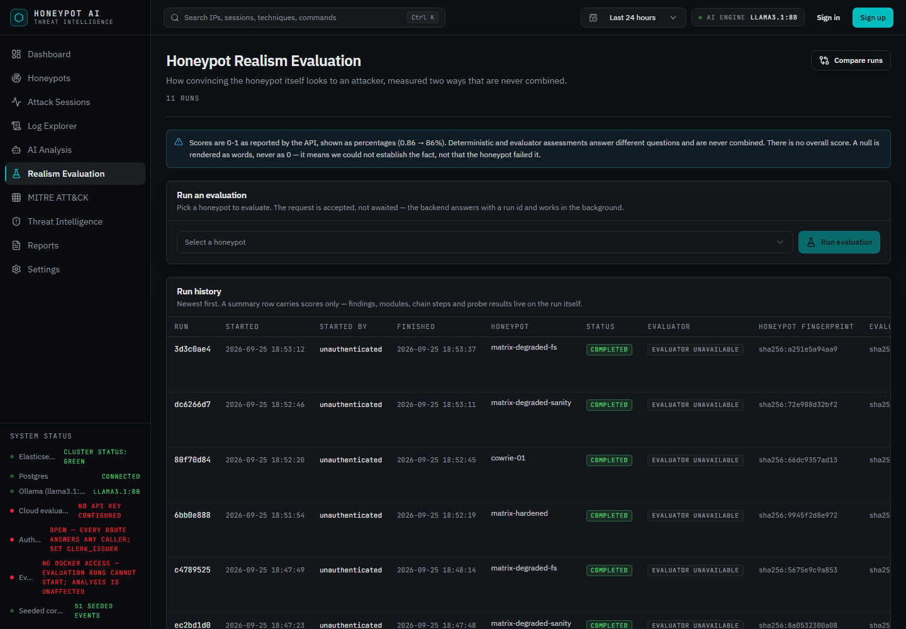
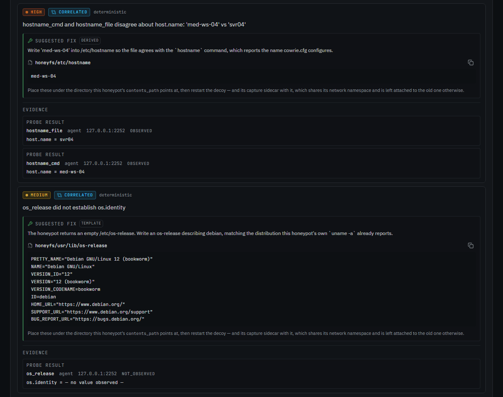
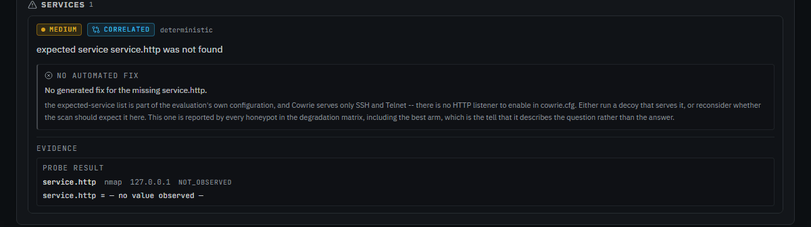

# Hivemind

**Evidence-grounded honeypot analysis, and automated evaluation of the honeypot itself.**

Hivemind does two things with one honeypot.

It **analyses attacks**: ingesting live telemetry, reconstructing attacker sessions,
classifying behaviour with a local LLM, mapping commands to MITRE ATT&CK, extracting
indicators of compromise, and producing threat reports.

Then it **turns around and attacks the honeypot itself**: an SSH agent and a set of
static probes exercise the decoy across six characteristics and report how convincing it
would look to an intruder, so a developer learns where the illusion breaks before an
attacker does.

Its defining property is **provenance**: every conclusion the interface shows expands
into the exact log line that produced it, and nothing is presented as fact unless
telemetry supports it. An ATT&CK technique is marked *observed* only when a deterministic
rule matched the command — never because a model suggested it — and a fact nobody could
establish is reported as unknown rather than as a zero.

Based on *"Beekeeper: Accelerating Honeypot Analysis With LLM-Driven Feedback"*
(Ilg, Germek, Duplys & Menth, IEEE Access vol. 13, 2025).

> **Why is it built this way?** [`OVERVIEW.md`](OVERVIEW.md) covers the design rationale,
> the full feature list and the technical reference — every operational detail that used
> to live in this file.

---

## Screenshots

The first four screenshots show **real attack traffic** captured by the live honeypot on
Google Cloud (`gcp-wild-01`) between 5 and 9 November 2026; the classifications come from
the local model analysing five of those sessions.

**Dashboard** — seven days of live traffic: 3 million events from 106,000 sessions. The
traffic ends on 9 November, when the honeypot's own egress guard stopped it for the rest
of the month. The exact window and the queries that re-count these figures are in
[OVERVIEW.md](OVERVIEW.md#figures-in-the-readme-screenshots-checked-2026-11-12).



**Sensor page** — the live honeypot itself: what it is disguised as (the `web-server`
persona) and since when, every recorded configuration change, and its traffic, cut at each
change so periods can be compared.



**Attack sessions** — captured sessions, newest first, with the campaigns above them:
sessions that ran the identical command sequence, grouped deterministically. These are
botnets replaying one script from many addresses.



**MITRE ATT&CK mapping** — one live session (`595b6c411118`) on the Enterprise matrix. The
four highlighted techniques are *observed*: a deterministic rule matched the command.



**Threat intelligence** *(seeded demo data)* — extracted indicators, each carrying its own
provenance tier. `OBSERVED` came straight from telemetry; `CORRELATED` was derived across
more than one session.



**Realism evaluation** — run history for the half that attacks the honeypot, with both
fingerprints, the evaluator's status and who started each run. The honeypot column shows
the degradation matrix: four arms of one image, each differing in a single declared
respect, carrying four different honeypot fingerprints under one shared configuration
fingerprint.



**Remediation** — each finding carries the fix for it, beneath the defect it repairs.
`DERIVED` marks a value read from the honeypot's own evidence — here the hostname its
`hostname` command actually returned; `TEMPLATE` marks a starting point to review before
applying. The os-release fix writes `usr/lib/os-release`, the symlink target, because a
patch to the link applies cleanly and does nothing.



**And where there is no fix, it says so.** Cowrie has no HTTP listener to enable, so
nothing in its configuration can satisfy this finding. A refusal is shown with the same
weight as a patch, because a reader who applied everything on screen must not be able to
believe they had addressed the whole run.



---

## Installation

Two ways in. **Run it** — everything in containers, one command. **Develop on it** — the
infrastructure in containers and the backend and frontend on the host, with reload.

### Requirements

| | |
|---|---|
| Docker Desktop | runs Cowrie, the web honeypot, Filebeat, Elasticsearch, Postgres, Redis |
| [Ollama](https://ollama.com) | on the host, for GPU access |
| GPU | 8 GB VRAM is sufficient |
| Python | 3.12 — only to develop on it; the container carries its own |
| Node.js | 22.13+ or 24+ — same |
| `nmap` | bundled in the backend image; install it on the host only for a host-run backend |

The packet-capture sidecar (`nicolaka/netshoot`, pinned by digest) is declared in
`docker-compose.yml` and pulled with everything else.

Hivemind runs **next to the honeypot it evaluates, never above it**. The evaluation half
`docker exec`s into the decoy's container, the capture sidecar shares its network
namespace, and the target is resolved from server-side settings so that no request can
ever name an address. That is why there is no hosted backend to point this at: one
install per honeypot host is the design, not a limitation of the packaging.

---

## Run it

```bash
ollama pull llama3.1:8b        # once; confirm `ollama ps` reports 100% GPU
docker compose --profile app up -d
```

Open <http://localhost:8080>. That brings up the infrastructure *plus* the backend
(`:8000`) and the dashboard (`:8080`), applies the database migrations, installs the
Elasticsearch pipeline and template, and seeds the demo corpus. Every port binds to
`127.0.0.1` only.

Ollama stays on the host deliberately — a container would not reach the GPU on Windows,
and the model only fits on an 8 GB card at `num_ctx` 8192. The backend reaches it through
`host.docker.internal`.

Two things worth knowing before you use it in anger:

- **The containerised backend cannot run evaluations, deliberately.** Driving the
  honeypot's container from inside a container would mean sharing the Docker socket, and
  anything that reaches that socket can take the host — so it is not mounted. Analysis is
  completely unaffected: ingest, sessions, the seven-stage pipeline, ATT&CK mapping,
  indicators and reports all work. An evaluation started this way fails at its first
  precondition with a `ResetError` and leaves no record, rather than producing a run whose
  facts are all `unknown`. The status dashboard says so up front — *"no Docker access —
  evaluation runs cannot start; analysis is unaffected"* — so you are not left to discover
  it by starting one. To run evaluations, use the host install below: it calls Docker as
  your own user and shares nothing. `docker-compose.yml` documents the one-line change if
  you would rather accept the trade.
- **Without Clerk configured the API answers every caller**, which it says on startup and
  on the status dashboard. That is defensible bound to `127.0.0.1` and nowhere else. See
  [`OVERVIEW.md`](OVERVIEW.md) for how to turn it on.

### Optional: third-party lookups

With keys, attacker pages show AbuseIPDB's reputation for the address, and the Threat
Intelligence table can check hashes, URLs and public IPs against VirusTotal. Both are
labelled third-party and feed nothing else. Put the keys in a `.env` file **at the repo
root** (it is gitignored), then recreate the backend:

```
ABUSEIPDB_API_KEY=...
VIRUSTOTAL_API_KEY=...
```

```bash
docker compose --profile app up -d backend
```

The status dashboard shows each as *connected* once its key is read. Without keys both
features say they are off; nothing else changes.

---

## Develop on it

### 1. Infrastructure

```bash
docker compose up -d
```

Brings up Elasticsearch (`:9200`), Postgres (`:5432`), Redis (`:6379`),
Cowrie (`:2222` SSH, `:2223` Telnet), the web honeypot (`:8088` HTTP) and Filebeat. Every
port binds to `127.0.0.1` only.
Kibana is optional and off by default: `docker compose --profile tools up -d kibana`
(`:5601`).

**Live honeypot (optional).** If a Cowrie VM is deployed on the internet, `wild-pull` copies
its log and finished terminal recordings home over SSH every five minutes and Filebeat indexes it as `gcp-wild-01`. Set the
first four variables in the repo-root `.env`, then `docker compose --profile wild up -d wild-pull`:

| Variable | Value |
|---|---|
| `WILD_HOST` | the VM's external IP |
| `WILD_USER` | the admin account on it (SSH on port `50022`; override with `WILD_PORT`) |
| `WILD_HOST_KEY` | the VM's pinned host key, `ssh-ed25519 AAAA...`; any other key is refused |
| `WILD_KEY_FILE` | path to the private key on this machine; mounted read-only |
| `WILD_PULL_HOST` | optional: the address `wild-pull` uses instead of `WILD_HOST`, because a container reaches the host's tunnels as `host.docker.internal` |
| `WILD_EVAL_HOST` | optional: the evaluation Cowrie's address when it differs from `WILD_HOST` (`127.0.0.2` with IAP tunnels); `deploy_persona` checks the twin there |
| `GCP_PROJECT`, `GCP_ZONE`, `GCP_INSTANCE` | only for the IAP tunnels below: which VM `iap-tunnels.ps1` opens them to |

**Reaching the VM through IAP (recommended).** Google's Identity-Aware Proxy carries SSH to the
VM, so no firewall rule has to name your home IP, which changes. Install the Google Cloud CLI
and run `gcloud auth login`. Add a firewall rule that admits only `35.235.240.0/20` (IAP's
range) on ports 50022, 2222 and 2223, and drop any rule that lists your own address. In the
repo-root `.env` set `GCP_PROJECT`, `GCP_ZONE` and `GCP_INSTANCE`, plus `WILD_HOST=127.0.0.1`,
`WILD_PORT=22022`, `WILD_PULL_HOST=host.docker.internal` and `WILD_EVAL_HOST=127.0.0.2`. Then
run `infra/wild-vm/iap-tunnels.ps1` in PowerShell: it opens three local listeners
(`127.0.0.1:22022` to the admin SSH, `127.0.0.2:2222` and `:2223` to the evaluation Cowrie),
`-Stop` ends them, and `-Register` once makes it run at every logon. `backend/.env.example`
shows the `gcp-eval-01` target in this form. Without IAP: leave `WILD_PULL_HOST` and
`WILD_EVAL_HOST` unset, set `WILD_HOST` to the VM's IP and `WILD_PORT=50022`, and keep a
firewall rule for your IP.

The VM side is `infra/wild-vm/`: Cowrie's config and run script (deploy steps in its
header) and `guard.sh`, which every five minutes ages out rotated logs and terminal recordings after 90 days and
stops Cowrie if free disk drops under 1 GB or the month's internet-bound traffic passes 900 MB of
the free tier's 1 GB (our own IAP traffic -- pulls, admin SSH, evaluation -- is not counted; Google bills it as free). It lifts a stop by itself; `journalctl -t hivemind-guard` on the VM says why.
It also rate-limits the live honeypot per source /24 -- SSH (22) to 2 new connections a minute,
burst 6, 3 at once; telnet (23), 96% of the traffic, to one every 10 minutes, burst 2, 1 at once;
the knobs are at the top of the script -- so flood bots cannot spend the month's egress; the
evaluation Cowrie is never limited. Bytes per port are logged hourly, and one month's budget can be
raised by hand with `echo BYTES >/var/lib/hivemind/budget-YYYY-MM`. `iptables -L DOCKER-USER -v` shows what was dropped.
The evaluation half measures a second Cowrie on the same VM (`run-cowrie.sh eval`, ports 2222 and 2223,
reachable only through IAP, or from your IP without it) as target `gcp-eval-01`, reset and read through a key that can do nothing else
(`setup-eval-gate.sh`); `backend/.env.example` has its `EVALUATION_TARGETS` entry.
To put a persona on both VM Cowries, first copy the new `run-cowrie.sh` to the VM, once, before the first `--apply` (which refuses until it is there):

```
scp -P 50022 -i KEY infra/wild-vm/run-cowrie.sh USER@VM:/opt/hivemind/
sed -i 's/\r$//' /opt/hivemind/run-cowrie.sh && chmod 755 /opt/hivemind/run-cowrie.sh   # on the VM
```

Then run `python -m scripts.deploy_persona <name>` from `backend/` (a dry run; `--apply` acts, and drops live sessions). `python -m scripts.deploy_persona --revert --apply` undoes it: it removes `personas/current`, restarts both Cowries on the setup they ran before any persona, and records that.

**Personas (optional).** `infra/cowrie/personas/` holds three disguises for the decoy (a
web server, a database server, a Raspberry Pi), each a short `persona.yaml` of facts that
`scripts.build_persona` renders into every Cowrie file that states them, so a persona
cannot contradict itself. `docker compose --profile personas up -d` runs them as extra
evaluable arms; after editing a `persona.yaml`, run `python -m scripts.build_persona` from
`backend/` and commit the regenerated files. `run_degradation_matrix.py --personas`
compares them.

### 2. Local model

```bash
ollama pull llama3.1:8b
```

Confirm it runs on the GPU — `ollama ps` must report `100% GPU`. A silent fall back to
CPU makes every analysis several times slower with no error.

### 3. Backend

```bash
cd backend
python -m venv .venv
.venv/Scripts/python -m pip install -e ".[dev]"       # Linux/macOS: .venv/bin/python
cp .env.example .env                                  # optional — every value is a default
.venv/Scripts/python -m alembic upgrade head
EVALUATION_TARGET_HOST=127.0.0.1 .venv/Scripts/python -m uvicorn app.main:app --port 8000
```

To evaluate more than the one local Cowrie (the degradation-matrix arms, the GCP evaluation
Cowrie), put an `EVALUATION_TARGETS` map in `backend/.env.evaluation` -- the entries are in
`backend/.env.example` -- and add `--env-file .env.evaluation` to the command above. A separate
file, because `backend/.env` is also read by the test suite, which needs the map empty.

On first start the backend installs the Elasticsearch ingest pipeline and index
template, then seeds a deterministic corpus so every screen has data before any attacker
connects.

`EVALUATION_TARGET_HOST` matters only for the realism evaluation: it defaults to the
compose service name `cowrie`, which does not resolve from a backend running on the host.

Set `REDIS_URL=redis://127.0.0.1:6379/0` only to run more than one uvicorn worker: it lets
a progress socket on one worker see a run on another. A single worker needs nothing. For a
host-run backend, the optional third-party keys go in `backend/.env`.

### 4. Frontend

```bash
cd frontend
npm install
echo "VITE_API_BASE_URL=http://localhost:8000" > .env
npm run dev
```

Open <http://localhost:8080>. There is no demo provider: without `VITE_API_BASE_URL` the app
calls `http://localhost:8000`, so the backend must be running.

### 5. Generate traffic (optional)

```bash
ssh -p 2222 root@127.0.0.1     # any password is accepted
```

Type a few commands, then `exit`. They appear in the Log Explorer within seconds, and the
session page can replay the terminal. For web traffic, browse `http://127.0.0.1:8088/` or
`curl http://127.0.0.1:8088/.env`; requests appear under the `web-01` honeypot.
A scripted generator is also available:

```bash
cd backend && .venv/Scripts/python scripts/generate_traffic.py
```

### 6. Scripts worth knowing

Run from `backend/` with the venv's Python, as `python -m scripts.<name>`:

| Script | What it does |
|---|---|
| `preflight [--warm]` | checks a running stack is ready to demo; `--warm` loads the model first |
| `probe_candidates` | ranks commands real attackers ran against what the evaluator's probes cover |
| `mapping_eval [--runs N]` | ATT&CK mapping precision/recall, rulebook alone vs rulebook + model |
| `run_degradation_matrix [--personas] [--repeat N]` | evaluates every matrix arm (`--personas`: the three honeypot personas instead); `--repeat` reports each score's spread |
| `build_persona [--check] [name]` | renders `infra/cowrie/personas/*/persona.yaml` into Cowrie's files; `--check` fails on drift |
| `record_change <honeypot-id> "<detail>" [--kind rate-limit\|note] [--at <ISO time>]` | records a non-persona configuration change of a sensor (e.g. a rate limit switched on), which starts a new period on its sensor page; local database only |
| `rotate_personas [--apply]` | deploys the persona the experiment schedule (`infra/cowrie/personas/experiment.yaml`) says is due on the live honeypot; a dry run by default, and `--apply` runs `deploy_persona`, which restarts the live Cowrie and drops its sessions |
| `persona_experiment [--now <ISO time>]` | prints the persona experiment's report (blocks as they ran, per-arm metrics, permutation tests) from the local database and Elasticsearch; changes nothing, and is marked INTERIM until the last block ends |
| `prune --older-than 90d [--apply]` | retention, dry run by default; run it in the stack as `docker compose --profile tools run --rm prune ...` so it can reach the log volumes |

---

## License

Licensed under the [Apache License 2.0](LICENSE).

Cowrie is deliberately attackable software. Its ports bind to `127.0.0.1` only and it
must not be exposed to the internet in this configuration.
